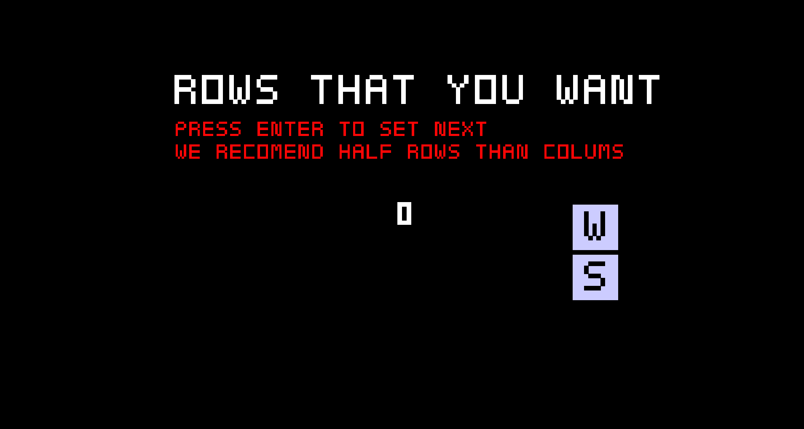

# Game of Life (my own variant, since the algorithm is different) in C++ (Win32, no libraries)

[Conway's Game of Life](https://en.wikipedia.org/wiki/Conway%27s_Game_of_Life) in C++ using only the Windows API: the window, the keyboard input and the drawing (a software renderer that paints pixel by pixel, with text and numbers) are written by hand, with no SDL or OpenGL.

> Personal project (September 2024). The Win32 window and renderer base follows Dan Zaidan's tutorial [*How to make a game in C++*](https://www.youtube.com/playlist?list=PL7Ej6SUky135IAAR3PFCFyiVwanauRqj3); the simulation and the interface are mine.

## Controls

**Setup**
- `W` / `S`: increase or decrease the rows (and then the columns) in steps of 100.
- `Enter`: confirms the rows, then the columns, and starts. The initial board is random.

**Simulation**
- Hold `F`: freezes the simulation.
- `R`: goes back to the setup screen.
- `Esc`: quit.

## Running it

Windows with Visual Studio: open `TutorialF.sln` and run.

## Files

| File | What it does |
|---|---|
| `windows32_plataform.cpp` | Win32 window, main loop and input |
| `renderer.cpp` | Software rendering: rectangles, text and numbers |
| `game.cpp` | Setup screen and Game of Life rules |

## Possible improvements

- Camera with zoom and panning to explore large boards (planned).
- This version focuses on getting it working; the optimized C version (tiling, OpenMP, cache analysis) lives in [Game-of-Life-optimization](https://github.com/jaimeamse/Game-of-Life-optimization).
